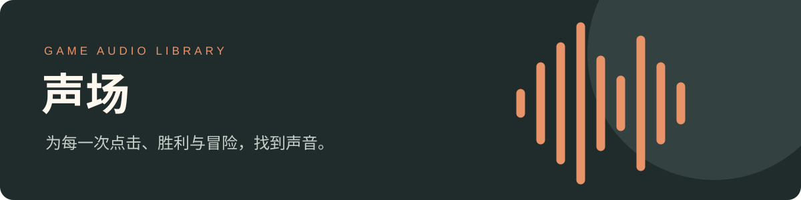

# 声场 · 游戏音频资源库

**让你的游戏，听起来更完整。**

1,982 个音频 · 11 类用途 · 25 个来源 · MP3 / WAV / OGG

[**▶ 打开试听与下载目录**](https://lilishader.github.io/game-audio-library/)　 ·　 [**↓ 下载全部音频**](https://github.com/LiLiShader/game-audio-library/releases/download/library/game-audio-library-all.zip)　 ·　 [更新指南](docs/维护指南.md)

---

## 从这里开始

1. **找声音**：打开 [在线目录](https://lilishader.github.io/game-audio-library/)，按用途、来源和格式筛选，或搜索文件名与中文用途。
2. **先试听**：点击播放即可试听。收藏喜欢的声音，使用底部播放器调节进度与音量。
3. **放进游戏**：下载单个原始文件，或按分类下载 ZIP。也可以点击「复制给 AI」，获得文件链接、用途与许可信息。

无需登录即可浏览、试听和下载。收藏仅保存在当前浏览器。音频保持原始格式和音量；OGG 播放支持取决于浏览器。

## 按用途下载

| 分类 | 适合使用在 | 文件数 | 整类下载 |
| --- | --- | ---: | --- |
| 01 · [背景音乐](https://lilishader.github.io/game-audio-library/?category=01) | 场景氛围与循环音乐 | 4 | [下载 ZIP](https://github.com/LiLiShader/game-audio-library/releases/download/library/category-01.zip) |
| 02 · [界面交互](https://lilishader.github.io/game-audio-library/?category=02) | 按钮、弹窗、开关与翻页 | 330 | [下载 ZIP](https://github.com/LiLiShader/game-audio-library/releases/download/library/category-02.zip) |
| 03 · [核心玩法](https://lilishader.github.io/game-audio-library/?category=03) | 消除、攻击、脚步与环境 | 1190 | [下载 ZIP](https://github.com/LiLiShader/game-audio-library/releases/download/library/category-03.zip) |
| 04 · [道具技能](https://lilishader.github.io/game-audio-library/?category=04) | 魔法、增益与道具触发 | 58 | [下载 ZIP](https://github.com/LiLiShader/game-audio-library/releases/download/library/category-04.zip) |
| 05 · [障碍机关](https://lilishader.github.io/game-audio-library/?category=05) | 碰撞、破碎与机关解锁 | 245 | [下载 ZIP](https://github.com/LiLiShader/game-audio-library/releases/download/library/category-05.zip) |
| 06 · [奖励收获](https://lilishader.github.io/game-audio-library/?category=06) | 金币、宝箱与礼物 | 56 | [下载 ZIP](https://github.com/LiLiShader/game-audio-library/releases/download/library/category-06.zip) |
| 07 · [收集图鉴](https://lilishader.github.io/game-audio-library/?category=07) | 相册、拼图与成就收集 | 8 | [下载 ZIP](https://github.com/LiLiShader/game-audio-library/releases/download/library/category-07.zip) |
| 08 · [关卡结果](https://lilishader.github.io/game-audio-library/?category=08) | 胜利、失败与结算 | 78 | [下载 ZIP](https://github.com/LiLiShader/game-audio-library/releases/download/library/category-08.zip) |
| 09 · [商店消费](https://lilishader.github.io/game-audio-library/?category=09) | 购买与交易反馈 | 3 | [下载 ZIP](https://github.com/LiLiShader/game-audio-library/releases/download/library/category-09.zip) |
| 10 · [体力生命](https://lilishader.github.io/game-audio-library/?category=10) | 生命、体力与状态变化 | 9 | [下载 ZIP](https://github.com/LiLiShader/game-audio-library/releases/download/library/category-10.zip) |
| 11 · [人声语音](https://lilishader.github.io/game-audio-library/?category=11) | 语音播报与人物反馈 | 1 | [下载 ZIP](https://github.com/LiLiShader/game-audio-library/releases/download/library/category-11.zip) |

## 资源与许可

- **公共音效**：来自 OpenGameArt 与 Kenney，原始来源记录标注为 CC0 1.0；随文件保留 `SOURCE.txt`、作者及来源链接。
- **项目音频**：Blossom、mahjong-match、tile-vertical；维护者已确认可以公开分发，供课堂学习使用。它们不自动适用 CC0，其他用途请向维护者确认。
- 原文件名与分类目录均保留；相同内容在不同项目中可能重复，共 1,966 个不同的 SHA-256。目录保留这些版本以便追溯。
- [查看许可说明](LICENSE.md) · [原始音频目录](audio/) · [机器可读清单](catalog.json)

## 持续更新

在原音频文件夹添加或调整文件后，运行本机的「更新音频库.command」，索引、下载包与 GitHub Pages 会随发布更新。也支持保持运行的监听模式。详细操作见 [维护指南](docs/维护指南.md)。

> 在线目录会在 GitHub Pages 部署完成后更新，通常需要几分钟；并非修改本地文件后立即出现在网页上。

---

由 LiLiShader 整理，面向游戏制作学习者。最近内容更新：2026-11-07。
